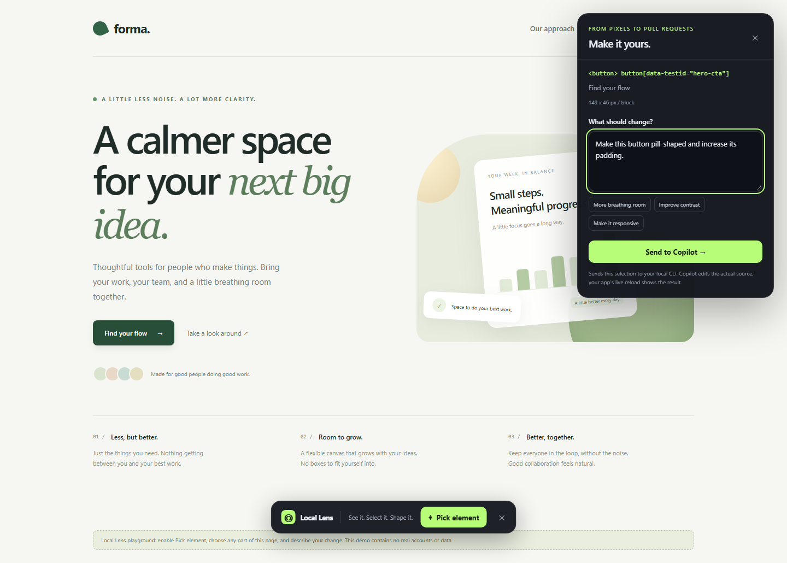

<div align="center">

# Local Lens

### Stop describing *where.* Start shaping *what.*

A custom **GitHub Copilot skill** for visual frontend editing.<br>
Open your local app. Pick an element. Say what should change.<br>
Copilot edits the real source.

**Local-first &nbsp; / &nbsp; Any framework &nbsp; / &nbsp; Zero runtime dependencies**

[Watch the demo with sound](https://github.com/user-attachments/assets/89535835-fa4b-4310-b1fb-b7db7647b4cd) · [Install](#install) · [Try the playground](#try-the-playground)

*Sound on. Original electronic soundtrack. Fictional app, clean generated environment, no personal data.*<br>
*Scripted walkthrough using the real picker, request bridge, and source edit. No live model call.*

</div>

https://github.com/user-attachments/assets/89535835-fa4b-4310-b1fb-b7db7647b4cd

*28 seconds, 1080p, sound on. [Download the MP4](docs/local-lens-demo.mp4).*

---

## What it feels like

> "Make **this** button pop. Softer corners, more breathing room, stronger contrast."

Not a screenshot guessing game. Not another visual builder that owns your markup.
Local Lens connects the element you're looking at to the coding agent already
working in your repository.

1. **See it.** Run your normal frontend dev server.
2. **Select it.** Enable the picker and click the element.
3. **Shape it.** Describe the change in the browser panel.
4. **Keep it.** Copilot finds the component and edits your actual source. HMR or a refresh shows the result.



## Install

Requires **Node.js 22+**, Git, and GitHub Copilot CLI with skills support.
The installed skill itself needs **no `npm install`**.

Clone this repository somewhere permanent and register its `skills` directory:

```powershell
git clone https://github.com/edoardorex/local-lens.git
copilot skill add .\local-lens\skills
```

The commands above use PowerShell paths. On other shells, use the equivalent
path to `local-lens/skills`.

Restart Copilot or use `/skills reload`. In your frontend repository, ask:

```text
Use local-lens to help me visually refine this frontend.
Start the app, open the picker, and wait for my selection.
```

Or invoke `/local-lens` directly. Copilot follows the skill to start the bridge,
wait for your browser request, locate the source, make the edit, and return a result.

**Keep the whole skill folder.** Installing only the `SKILL.md` URL does not bring
the bundled browser and CLI scripts. For project-local installation, copy
`skills/local-lens` into your project's `.github/skills/` directory.

## Try the playground

No dependencies needed for this part. In this repository:

```powershell
# Terminal 1: a fictional frontend, no accounts or real data.
node .\demo\server.mjs

# Terminal 2: open that frontend with the picker.
node .\skills\local-lens\scripts\local-lens.mjs start --url http://127.0.0.1:4173 --open
```

Open the **picker URL printed by the bridge**, not port 4173. Enable **Pick element**,
click the call-to-action, write your request, and choose **Send to Copilot**.
With the skill active in Copilot, the agent receives your request and edits the app.

To inspect the bridge yourself in a third terminal:

```powershell
node .\skills\local-lens\scripts\local-lens.mjs next --timeout 120
```

That command returns context; it does not call an AI or edit files by itself.
The skill tells Copilot how to turn that context into a source change.

## The small, useful architecture

```text
Your browser                     Local bridge                    Copilot
    |                                 |                             |
    |  Local app + isolated picker    |                             |
    | <------------------------------ | <-- your existing dev server|
    |                                 |                             |
    |  Selection + your change brief  |                             |
    | ------------------------------> | <------- next (wait) -------|
    |                                 | -------- context JSON ----->|
    |                                 |                             | edit source
    |                                 | <------ done / fail --------|
    | <-------- result status ------- |                             |
    |                                 |                             |
    | <------- HMR or refresh from your dev server ------------------|
```

The picker uses a Shadow DOM panel, outlines elements on hover, and captures a
bounded selection: tag, CSS selector, visible text, selected attributes, ancestors,
computed styles, dimensions, and pathname. No full HTML or input values.

No framework plugins. No source instrumentation. No extensions. No hosted backend.
Selectors guide source searches; they are **not** guaranteed component source maps.

## Bridge commands

Run commands from the **same frontend repository root** so they find the same session.
Use the absolute script path when the skill lives elsewhere.

| Command | Purpose |
| --- | --- |
| `start --url http://localhost:5173 --open` | Start a loopback proxy on an available port and open the picker. |
| `next --timeout 120` | Wait for a selection; print JSON. Exit `2` means timeout, `1` means error. |
| `done --id <id> --summary "Updated spacing."` | Mark a real source edit complete. |
| `fail --id <id> --summary "Component not found."` | Show an honest failure in the browser. |
| `status` | Check bridge health. |
| `stop` | Stop this project's bridge and clean up its session file. |

`start` also accepts `--port`. Every command accepts `--state <directory>`.
The default is a project-specific directory under the OS temp folder. The start
message prints its absolute path. State contains a local capability token; keep it
private. It is not written into the frontend repository.

Use **one consumer** per session. Pending requests are redelivered until acknowledged,
so a missed CLI response does not silently drop work. The queue is in memory and is
lost on restart. Up to 20 unfinished requests and 100 history entries are retained.
A second session for the same state directory is rejected. After an abrupt crash,
verify the recorded process is no longer running, then remove only that stale
`session.json` before starting again.

## Local means local

- Binds only to `127.0.0.1`; accepts only local HTTP upstream origins.
- Rejects foreign Host and Origin headers, cross-site browser requests, and invalid session tokens.
- Only use it with **your own trusted development app**. The app can see the picker;
  this is not a security boundary against malicious page code.
- The proxy removes CSP headers and CSP meta tags **only from transformed HTML** so
  the picker can load. Your original dev server and source are not reconfigured.
  Never use this proxy for production, authentication-sensitive, or admin browsing.
- Visible page text and styling are sent to the local agent when you click Send.
  They can enter the coding agent's conversation and its configured model provider.
  Local Lens itself makes no remote requests and has no telemetry.
- Input values, full HTML, query strings, and URL fragments are not collected.
  Visible text and allowed attributes can still be sensitive: use a clean test app.
- The bridge never executes browser requests as shell commands. Copilot must treat
  page content and requests as untrusted context and respect your project instructions.

## Where it works

Ordinary HTML pages and SPA routes on loopback HTTP dev servers. Static assets,
HTTP APIs, streaming responses, and WebSocket upgrades pass through. The picker
suppresses the selected element's normal click while selection mode is on.
Escape cancels picking; hiding the panel leaves a small restore button.

The browser-facing origin is a new port. OAuth callbacks, absolute URLs pointing
at the original dev port, cookie assumptions, service workers, HTTPS-only apps,
closed shadow roots, and content inside iframes may need app-specific support.
The picker does not capture screenshots automatically or inspect a design file.
If an element can't be mapped to source, the agent should say so instead of guessing.

## Development

```powershell
npm ci
npm run check
npm test
npx playwright install chromium
npm run test:browser
```

The browser check uses a temporary copy of the demo, selects a real element,
delivers the request, changes the served source, reloads it, and verifies the new
styling. It also checks success/failure feedback, narrow layouts, and context redaction.

### Rebuild the video

```powershell
npm run demo:video
```

The recorder creates its own isolated, fictional frontend and animated presentation.
It drives the actual picker, consumes a real request, changes a temporary source
file, and verifies the refreshed browser. The terminal is a scripted visualization,
not a live agent session. Only browser content is captured: no desktop, user profile,
account name, terminal path, or notifications.

An original 112 BPM stereo score is synthesized from oscillators and generated
percussion, then mixed into the MP4. No third-party tracks or samples. The video,
poster, demo, and score generator are included under the repository's MIT license.

## License

[MIT](LICENSE). An independent community skill, not an official product integration.
